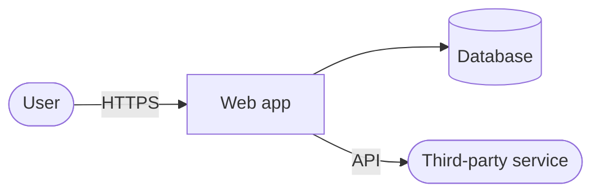

# Threat model — <product / feature>

## 1. What are we working on?
**Summary:** what the system does, who uses it, what data it holds.

| Element | Kind (entity / process / store / flow) | Data | Crosses trust boundary? |
|---|---|---|---|

**Assets worth protecting:** …
**Assumptions:** …
**Out of scope:** …

## 2. What can go wrong? (STRIDE)
| # | Element / flow | STRIDE | Threat | OWASP Top 10:2025 | Existing control (evidence) | Likelihood | Impact | Rating |
|---|---|---|---|---|---|---|---|---|

## 3. What are we going to do about it?
| # | Response (mitigate / avoid / transfer / accept) | Security requirement (ASVS area) | Owner | Risk ID | Obligation |
|---|---|---|---|---|---|

## 4. Did we do a good enough job?
- [ ] Every flow crossing a trust boundary has STRIDE coverage
- [ ] Every store with personal data or secrets has a disclosure threat
- [ ] Top threats shown to the founder; accepted risks recorded as decisions
- Gaps / next review trigger: …

## Sources
| Framework / reference | Version | Link | Date checked |
|---|---|---|---|

## Revision log
| Date | Change | By |
|---|---|---|
